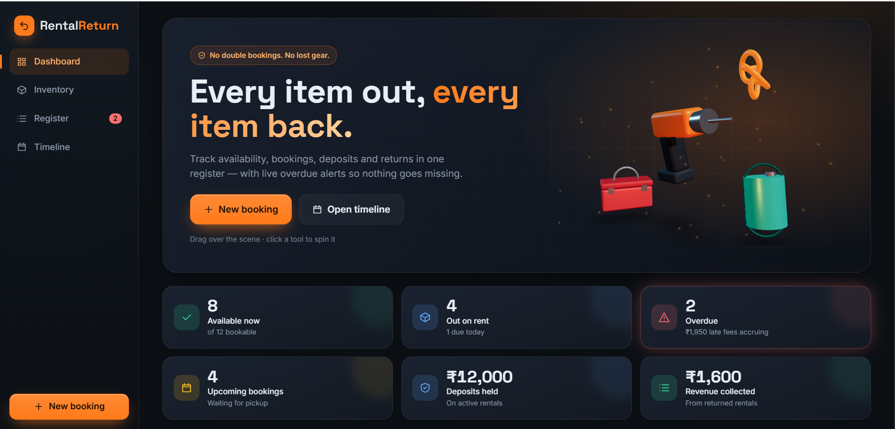
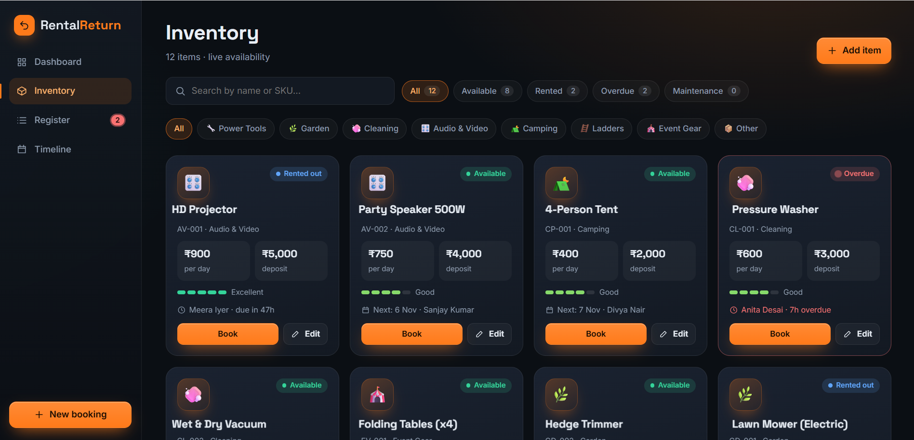
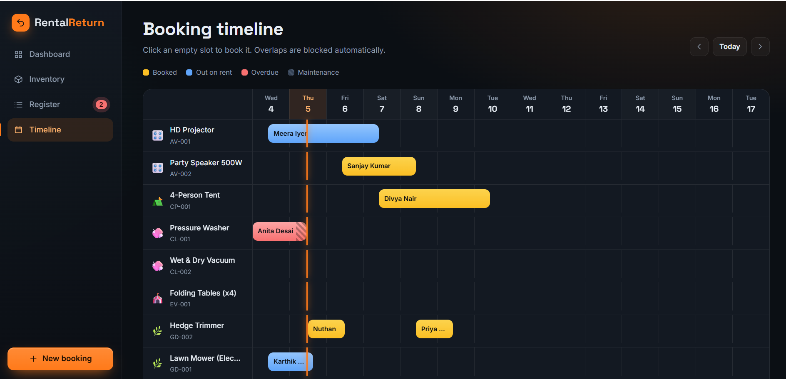
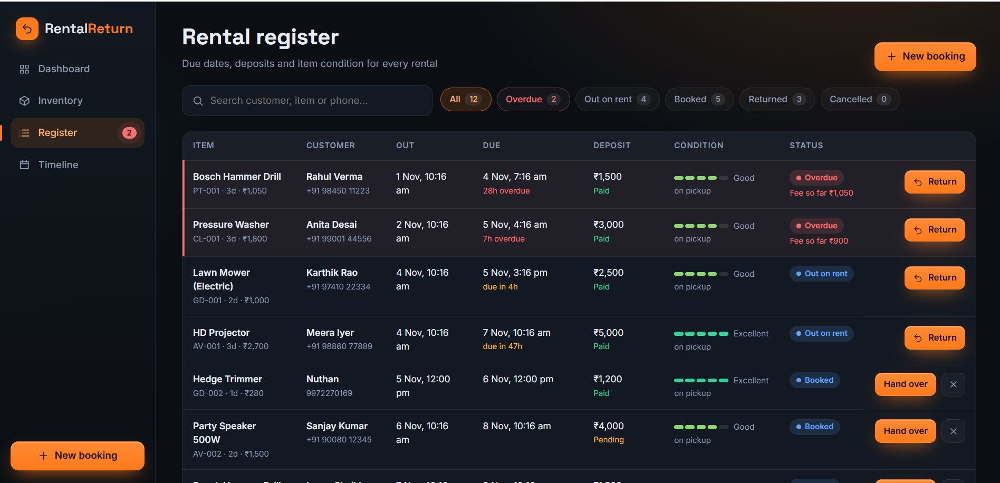
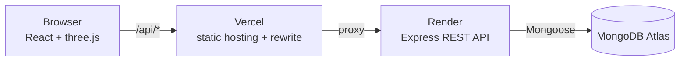
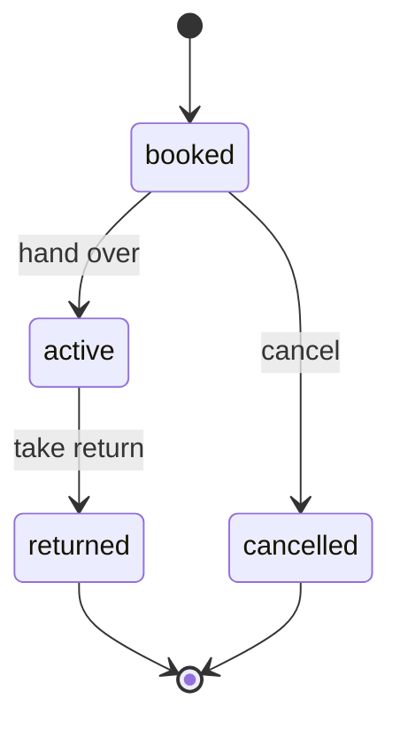

<div align="center">

# 🛠️ RentalReturn

### Equipment rental tracking that **prevents double bookings** and **flags overdue returns**

A full-stack rental register for small businesses: live availability, bookings, deposits, returns, late fees and item condition, with an interactive 3D dashboard.

[](https://YOUR-VERCEL-ADDRESS.vercel.app)
[](https://rentalreturn.onrender.com/api/health)


</div>

> **Note:** the API runs on a free server that sleeps when idle, so the first load of the demo can take up to a minute.

---

## 📸 Screenshots

| Dashboard | Inventory |
|---|---|
|  |  |

| Booking timeline | Rental register |
|---|---|
|  |  |

---

## 🎯 The problem

Rental businesses lose money in two ways: **the same item gets promised to two customers**, and **items quietly go overdue** with nobody noticing. RentalReturn tracks every item, booking and return in one register and makes both problems impossible to miss.

## ✨ Features

- **Double-booking prevention.** Overlapping bookings for the same item are rejected by the server (`409 Conflict`), and the booking form shows the clash live as you type.
- **Overdue flagging.** Picked-up items past their due time are flagged on the dashboard, in the register, on the timeline and in a sidebar badge, with late fees calculated automatically.
- **Live availability.** Every item is `available`, `rented`, `overdue` or `maintenance`, and shows who has it and when it's next booked.
- **Deposits and returns.** Deposit paid is tracked per rental. On return, the app records the item's condition, applies late and damage fees, and calculates the refund.
- **Item condition tracking.** Condition is recorded at pickup and on return. Items returned as `damaged` move to maintenance automatically.
- **Rental register.** Searchable, filterable table with due-date countdowns for every rental.
- **14-day booking timeline.** A Gantt-style view per item where you click an empty slot to book it.
- **Interactive 3D UI.** A three.js hero scene that follows the pointer and spins when you click a tool, plus inventory cards that tilt in 3D.
- **Responsive.** Sidebar becomes a bottom nav on phones, the register becomes stacked cards, and dialogs become bottom sheets.

## 🧠 Engineering highlights

| Topic | What I did |
|---|---|
| **Overlap detection** | Two bookings conflict when `existing.start < new.due AND existing.due > new.start`. Back-to-back bookings are allowed. |
| **Race conditions** | After inserting a booking, the server re-checks for a concurrent overlapping booking and rolls the new one back if it lost the race. |
| **Computed state** | `isOverdue` and the late fee are Mongoose virtuals calculated on read, so they are always current and never go stale in the database. |
| **Price snapshots** | Each rental stores the daily rate and deposit at booking time, so changing an item's price later never rewrites history. |
| **Validation** | Zod schemas validate every request on the server (dates, phone, SKU, ranges, max rental length), and the forms validate inline on the client. |
| **Error handling** | One error middleware maps Zod, Mongoose, duplicate-key and custom errors to a consistent JSON shape that the UI turns into field-level messages and toasts. |
| **Business rules** | An overdue item blocks new bookings, maintenance items can't be booked, items with open bookings can't be deleted, and only valid status transitions are allowed. |
| **Accessibility and motion** | Keyboard-accessible modals, ARIA labels, and `prefers-reduced-motion` support. The 3D scene falls back gracefully without WebGL. |

## 🏗️ Architecture



- **Frontend:** React 18 + Vite, hosted on Vercel
- **API:** Node.js + Express with Zod validation, hosted on Render
- **Database:** MongoDB Atlas (free tier) through Mongoose

### Rental lifecycle



## 🚀 Run it locally

Requires **Node.js 18+** and a MongoDB database (a free [MongoDB Atlas](https://www.mongodb.com/atlas) cluster works).

```bash
# 1. install everything
npm install
npm run setup

# 2. configure the database
cp server/.env.example server/.env        # on Windows: copy server\.env.example server\.env
# then edit server/.env and set MONGODB_URI, for example:
#   mongodb://127.0.0.1:27017/rentalreturn
#   mongodb+srv://<user>:<password>@<cluster>.mongodb.net/rentalreturn?retryWrites=true&w=majority

# 3. start the API (port 5000) and the React app (port 5173)
npm run dev
```

Open <http://localhost:5173>. The first time the database is empty it is seeded with 12 items and 11 rentals, including two overdue ones. Set `SEED=false` to turn that off.

### Environment variables (`server/.env`)

| Variable | Purpose | Default |
|---|---|---|
| `MONGODB_URI` | MongoDB connection string | none (starts a temporary in-memory database if empty) |
| `PORT` | API port | `5000` |
| `SEED` | Add demo data when the database is empty | `true` |
| `LATE_FEE_MULTIPLIER` | Late fee = days overdue × daily rate × this | `1.5` |

## 🔌 REST API

| Method | Endpoint | Purpose |
|---|---|---|
| GET | `/api/health` | Health and database status |
| GET | `/api/items` | All items with live availability |
| GET | `/api/items/:id` | One item |
| GET | `/api/items/:id/availability?start=&end=` | Would this booking clash? |
| POST | `/api/items` | Add an item |
| PUT | `/api/items/:id` | Edit an item or set maintenance |
| DELETE | `/api/items/:id` | Delete (blocked if it has open bookings) |
| GET | `/api/rentals?status=&overdue=true&q=&item=` | Rental register |
| POST | `/api/rentals` | Create a booking (`409` on overlap) |
| PATCH | `/api/rentals/:id/checkout` | Hand the item to the customer |
| PATCH | `/api/rentals/:id/return` | Take a return `{ conditionIn, damageFee, notes }` |
| PATCH | `/api/rentals/:id/cancel` | Cancel a booking that hasn't been picked up |
| GET | `/api/stats` | Dashboard numbers |

Errors always have the same shape:

```json
{ "error": { "status": 400, "message": "Please fix the highlighted fields", "details": [{ "field": "dueDate", "message": "Due date must be after the start" }] } }
```

Status codes: `400` validation · `404` not found · `409` conflict (double booking, duplicate SKU, blocked delete) · `500` unexpected.

## 💰 Fees and refunds

- **Late fee** = days overdue (rounded up) × daily rate × `LATE_FEE_MULTIPLIER`
- **Refund** = `max(0, deposit paid − late fee − damage fee)`. If the fees exceed the deposit, the return screen shows what the customer still owes.

## 📁 Project structure

```
rentalreturn/
├── server/src/
│   ├── index.js              app setup, DB connection, seeding
│   ├── models/               Item.js, Rental.js (virtuals: isOverdue, accruedLateFee)
│   ├── routes/               items.js, rentals.js, stats.js
│   ├── middleware/           validate.js, errorHandler.js
│   ├── utils/                rentalLogic.js (double-booking guard), seed.js, AppError.js
│   └── validators.js         Zod schemas
└── client/src/
    ├── App.jsx               app shell, data loading, modals
    ├── api.js                fetch wrapper + ApiError
    └── components/           Dashboard, Inventory, Rentals, Timeline,
                              BookingModal, ItemModal, ReturnModal, Hero3D, ui
```

## ☁️ Deployment

| Part | Platform | Notes |
|---|---|---|
| Frontend | Vercel | Root directory `client`; `client/vercel.json` rewrites `/api/*` to the API |
| API | Render | Root directory `server`; build `npm install`; start `npm start`; env `MONGODB_URI`, `NODE_ENV=production` |
| Database | MongoDB Atlas | Free M0 cluster |

## 🔭 What I would add next

- User accounts and staff roles
- Email or SMS reminders before a rental is due
- Item photos and damage-photo upload on return
- Online payment for deposits
- CSV export of the register
- Automated tests for the booking and fee rules

## 👤 Author

**Nuthan M**
GitHub: [@Nuthan1510](https://github.com/Nuthan1510)

If you like this project, a ⭐ on the repository is appreciated.
